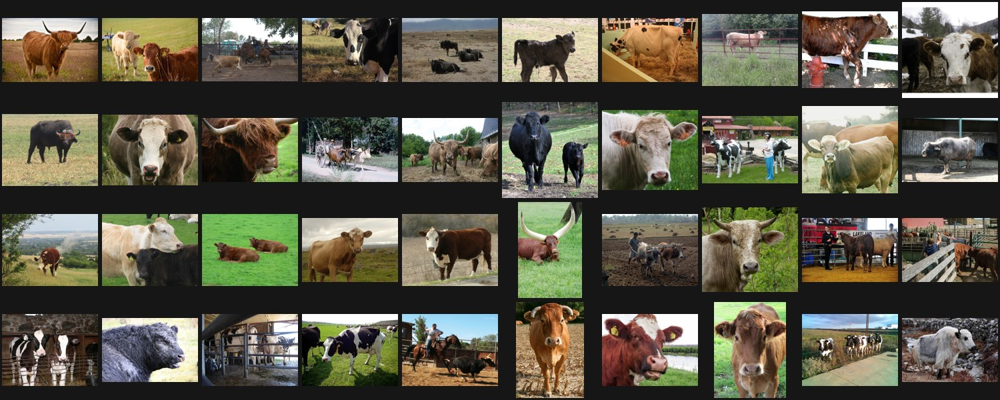
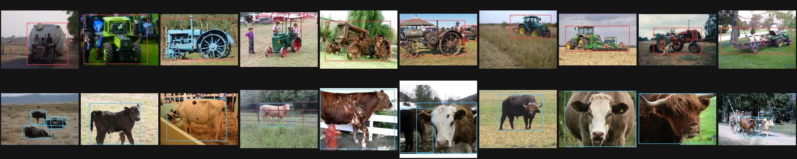
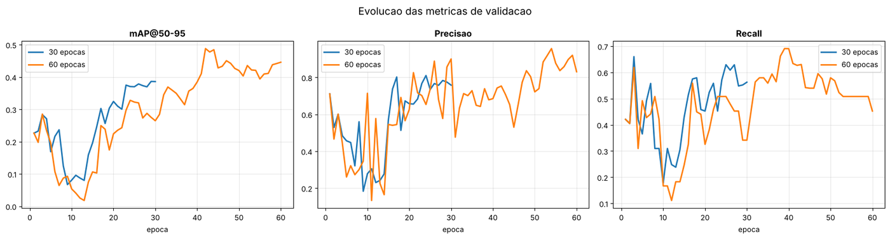
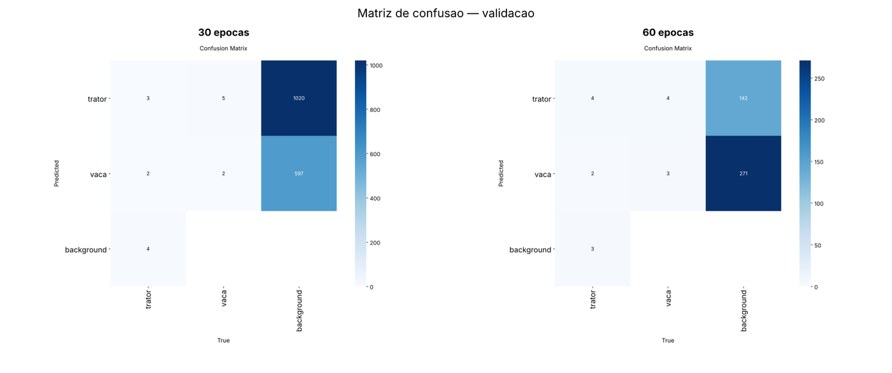
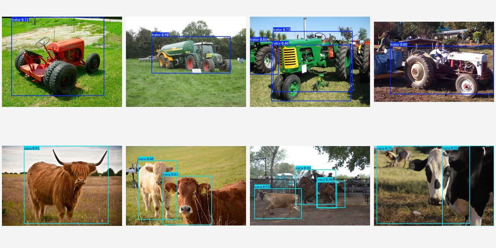

<p align="center">
  <a href="https://www.fiap.com.br/"></a>
</p>

<h1 align="center">FarmTech Solutions</h1>
<h3 align="center">Visão Computacional com YOLO — Detecção de Trator e Vaca</h3>

<p align="center">
  
  
  
</p>

**PBL Fase 6 — O Despertar da Rede Neural**

| | |
|---|---|
| **Aluno** | `Matheus Tavares Lima` |
| **RM** | `RM572808` |
| **Grupo** | `15` (solo) |
| **Notebook** | [`src/MatheusTavaresLima_rm572808_pbl_fase6.ipynb`](./src/MatheusTavaresLima_rm572808_pbl_fase6.ipynb) |
| **Vídeo demonstrativo** |https://youtu.be/FrMse98YQMU)|

---

## Sumário

- [1. O problema](#1-o-problema)
- [2. Entrega 1 — detector YOLO customizado](#2-entrega-1--detector-yolo-customizado)
- [3. Entrega 2 — comparação com abordagens concorrentes](#3-entrega-2--comparação-com-abordagens-concorrentes)
- [4. Como executar](#4-como-executar)
- [5. Estrutura do repositório](#5-estrutura-do-repositório)
- [6. Limitações declaradas](#6-limitações-declaradas)

---

## 1. O problema

A FarmTech Solutions expandiu seus serviços de IA para além do agronegócio e passou a
atuar em **visão computacional**. Este projeto atende a uma demanda concreta: demonstrar a
um cliente, de forma verificável, que um detector customizado reconhece objetos do
contexto rural a partir de uma base construída do zero.

As duas classes foram escolhidas por serem **operacionalmente relevantes e visualmente
disjuntas**:

| Classe | Representa | Aplicação na carteira da FarmTech |
|---|---|---|
| `trator` | ativo mecânico | controle de pátio, inventário de maquinário |
| `vaca` | ativo biológico | contagem de rebanho, saúde animal |

Um detector que confunde as duas não serve para nenhuma das duas aplicações — por isso
foram escolhidas classes que o modelo precisa realmente separar.

> O passo a passo completo, com código comentado e discussão dos achados, está no
> **[notebook](./src/MatheusTavaresLima_rm572808_pbl_fase6.ipynb)**. Este README não
> repete aquele conteúdo: apresenta o problema, resume o método e consolida os resultados.

---

## 2. Entrega 1 — detector YOLO customizado

### 2.1 A base de imagens

80 imagens do **Open Images Dataset V5** (Google), licença **CC BY 2.0**, divididas
conforme o enunciado:

| Split | trator | vaca | total |
|---|---:|---:|---:|
| Treino | 32 | 32 | 64 |
| Validação | 4 | 4 | 8 |
| Teste | 4 | 4 | 8 |
| **Total** | **40** | **40** | **80** |

Cada imagem é rastreável até o identificador original em
[`src/data/MANIFESTO.csv`](./src/data/MANIFESTO.csv).

**A curadoria foi a etapa de maior impacto.** A consulta inicial trouxe 150 candidatas;
**45 foram descartadas manualmente**, porque o rótulo textual da base não garante que a
imagem sirva para detecção:

| Motivo do descarte | Exemplos encontrados |
|---|---|
| Espécie errada sob o mesmo rótulo | búfalo, bisão, cabra, ovelha, antílope |
| Objeto errado sob o mesmo rótulo | empilhadeira, retroescavadeira, colheitadeira |
| Não é fotografia | ilustração, logotipo, anúncio impresso |
| Objeto irreconhecível | neblina densa, objeto ocupando menos de 2% do quadro |
| Objeto ausente | foto de feno rotulada como gado |

Treinar com esse ruído ensinaria o modelo a associar `vaca` a qualquer quadrúpede em
pasto. **A qualidade da curadoria limita o teto do modelo mais do que a arquitetura.**

<p align="center">
  
  <br><em>As 40 imagens aprovadas da classe <code>vaca</code></em>
</p>

### 2.2 Rotulação

Rotulação feita em **[Make Sense](https://www.makesense.ai)**, exportada em formato YOLO —
procedimento completo em [`document/other/COMO_ROTULAR.md`](./document/other/COMO_ROTULAR.md).

| | |
|---|---:|
| Caixas no conjunto de treino | **92** |
| — classe `trator` | 39 |
| — classe `vaca` | 53 |
| Caixas por imagem (média) | 1,44 |
| Balanceamento trator / vaca | 42,4% / 57,6% |

O notebook valida os rótulos **programaticamente antes do treino** (número de campos,
intervalo [0,1], índice de classe, caixa de área não nula) e os sobrepõe visualmente sobre
as imagens. Rótulo corrompido é a falha mais comum em projetos de detecção e a mais
silenciosa: a métrica não denuncia.

<p align="center">
  
  <br><em>Verificação visual dos rótulos sobre as imagens de treino</em>
</p>

### 2.3 Treinamento — duas simulações

Modelo base **`yolov8n`** (≈3,2 M de parâmetros), 640 px, lote 8, semente 42, sem early
stopping — a comparação 30 × 60 épocas só faz sentido se as duas rodadas completarem o
número de épocas pedido.

**Por que o menor modelo da família:** com 64 imagens de treino, um modelo maior não
encontra mais sinal — ele decora. A escolha é ditada pelo tamanho do dado.

### 2.4 Resultados — e por que não há vencedor

| Métrica | 30 épocas | 60 épocas | Variação |
|---|---:|---:|---:|
| Precisão | 0,7585 | **0,8311** | **+9,6%** |
| Recall | **0,5625** | 0,4524 | **−19,6%** |
| mAP@50 | 0,5692 | 0,5769 | +1,4% |
| **mAP@50-95** | 0,3858 | **0,4457** | **+15,5%** |

<p align="center">
  
  <br><em>As três curvas que contam a história: o mAP@50-95 e a precisão sobem com 60 épocas,
  o recall desce. Nenhum dos dois modelos domina o outro.</em>
</p>

**Métrica primária declarada antes dos resultados: `mAP@50-95`.** Ela exige caixa bem
posicionada em dez níveis de sobreposição, enquanto o `mAP@50` perdoa caixa "quase certa".

Três leituras:

1. **O que melhorou.** O `mAP@50-95` subiu 15,5%. O treino adicional refinou a
   **localização** — o modelo passou a desenhar caixas mais justas.
2. **O que piorou.** O recall caiu quase 20%, junto com a precisão subindo. O modelo de 60
   épocas ficou **conservador**: aperta o critério em cima do que já viu e passa a ignorar
   objetos atípicos. É o comportamento esperado de treino prolongado sobre 64 imagens.
3. **O que não mudou.** O `mAP@50` praticamente não se moveu. **Se este trabalho
   reportasse só `mAP@50`, concluiria "treinar mais não mudou nada" — e estaria errado.**

**Por classe (60 épocas):** `vaca` tem desempenho sensivelmente melhor que `trator`
(mAP@50 de 0,73 contra 0,41 aos 30 épocas). A causa provável é morfológica: vacas têm
silhueta consistente entre imagens, enquanto a classe `trator` reúne desde microtrator de
jardim até máquina agrícola de grande porte e modelos de época — variabilidade intraclasse
muito maior para 32 exemplos cobrirem.

<p align="center">
  
  <br><em>Matrizes de confusão na validação — 30 épocas à esquerda, 60 à direita</em>
</p>

**A escolha do modelo depende da aplicação, não da métrica:**

| Aplicação | Modelo | Razão |
|---|---|---|
| Contagem de rebanho | **30 épocas** | perder animal é pior que contar a mais |
| Inventário com conferência humana | **60 épocas** | menos alarme falso reduz revisão |
| Recorte automático do objeto | **60 épocas** | caixa mais justa |

Entregar "o de 60 épocas porque treinou mais" seria recomendação sem fundamento.

### 2.5 Teste — a demonstração ao cliente

As 8 imagens de teste nunca foram vistas pelo modelo e não têm rótulo.

<p align="center">
  
  <br><em>Detecções do modelo de 60 épocas nas 8 imagens de teste — 8/8 classes corretas</em>
</p>

| Modelo | Acerto de classe | Taxa de detecção | Inferência (CPU) |
|---|---:|---:|---:|
| YOLO customizada — 30 épocas | 8/8 (100%) | 100% | 74,8 ms |
| YOLO customizada — 60 épocas | 8/8 (100%) | 100% | 72,9 ms |

---

## 3. Entrega 2 — comparação com abordagens concorrentes

A Entrega 1 mostrou que o detector funciona. A Entrega 2 pergunta se ele é a **escolha
certa**. As mesmas 8 imagens de teste passaram por mais duas abordagens.

| | A — YOLO customizada | B — YOLO padrão (COCO) | C — CNN do zero |
|---|---|---|---|
| **Saída** | caixa + classe própria | caixa + classe genérica | **apenas classe** |
| **Localiza o objeto** | sim | sim | **não** |
| **Treino necessário** | sim | nenhum | sim |
| **Acerto de classe (8 img)** | 100% | 100% | 87,5% |
| **mAP@50-95 (validação)** | **0,4457** | não aplicável | não aplicável |
| **Tempo de treino** | ~30 min (CPU) | zero | 26,9 s |
| **Inferência (CPU)** | 72,9 ms | 94,1 ms | **5,5 ms** |

### 3.1 Facilidade de uso e integração

**YOLO padrão** vence com folga: três linhas de código, nenhum dado próprio. É o que se
testa primeiro, antes de decidir investir.

**YOLO customizada** exige o trabalho que domina o cronograma — coletar, curar, rotular,
organizar — mas o código de treino é uma chamada só. O custo está no dado, não no software.

**CNN do zero** parece a mais simples e é a mais traiçoeira: cada decisão de arquitetura,
normalização e regularização é responsabilidade de quem escreve, e erro em qualquer uma
produz um modelo que treina sem aprender.

### 3.2 Precisão — e a armadilha do resultado da YOLO padrão

Os 100% da YOLO padrão **não significam que ela resolve o problema.** O modelo nunca disse
"trator": disse `truck`, `motorcycle`, `car`, e o notebook traduziu esses rótulos por fora,
somando confianças por grupo. O mapeamento é frágil — um caminhão real na fazenda viraria
"trator" com a mesma confiança. Excelente como **baseline de custo zero**, inadequada como
**produto final** para um domínio específico.

**Com 8 imagens de teste, cada acerto vale 12,5 pontos percentuais.** Diferenças de um ou
dois acertos não são estatisticamente distinguíveis. O conjunto de teste permite afirmar
que as três abordagens funcionam no caso fácil; **não permite ordená-las**. A única
comparação defensável vem da validação, onde há rótulo e métrica de localização — e só a
YOLO customizada tem `mAP@50-95`, porque só ela foi treinada para produzir caixa nas
nossas classes.

### 3.3 Tempo de treinamento

A CNN treina em 27 segundos; a YOLO, em cerca de 30 minutos em CPU. Comparar esses tempos
diretamente engana — eles produzem coisas diferentes. E ambos são irrelevantes diante do
custo real: **a rotulação manual das 64 imagens levou mais tempo que os dois treinos
somados.** Em visão computacional aplicada, o gargalo quase nunca é a GPU.

### 3.4 Tempo de inferência

A CNN é **uma ordem de grandeza mais rápida** — resolve um problema muito menor, em
resolução menor (128 px contra 640 px). Para triagem de altíssimo volume onde só interessa
"tem gado nesta foto?", é a escolha certa. Para qualquer coisa que exija *onde*, não concorre.

### 3.5 Veredito

| Cenário do cliente | Abordagem | Justificativa |
|---|---|---|
| Prova de conceito em uma tarde | **B — YOLO padrão** | custo zero, mostra viabilidade |
| Contar e localizar animais no pasto | **A — customizada, 30 ép.** | recall maior; perder animal é o erro caro |
| Recorte automático para catálogo | **A — customizada, 60 ép.** | caixa mais justa |
| Triagem de milhões de imagens por classe | **C — CNN** | 1 a 2 ordens de grandeza mais rápida |

**Não existe abordagem vencedora — existe adequação ao requisito.** O requisito aqui é
localizar objetos, o que elimina a CNN e torna a YOLO customizada a entrega correta.

---

## 4. Como executar

### No Google Colab (recomendado)

1. Suba a pasta `dataset/` e a pasta `labels/` para `MyDrive/FIAP/fase6/` no seu Drive.
2. Abra o notebook no Colab e ative **Ambiente de execução → Alterar tipo → GPU**.
3. Execute **Ambiente de execução → Executar tudo**. A primeira célula instala a
   `ultralytics` e a segunda monta o Drive.

O notebook detecta sozinho se está no Colab ou local e ajusta os caminhos.

### Localmente

```bash
python3 -m venv .venv && source .venv/bin/activate
pip install -r config/requirements.txt
FASE6_RAIZ=. jupyter notebook src/MatheusTavaresLima_rm572808_pbl_fase6.ipynb
```

As células de treino **pulam automaticamente** se os pesos já existirem em `runs/`.
Apague essa pasta para forçar o treino do zero.

---

## 5. Estrutura do repositório

```
.
├── README.md
├── requirements.txt
├── assets/                          imagens usadas nesta documentação
│   ├── amostra_trator.jpg           as 40 imagens aprovadas da classe trator
│   ├── amostra_vaca.jpg             as 40 imagens aprovadas da classe vaca
│   ├── verificacao_rotulos.jpg      rótulos sobrepostos às imagens
│   ├── deteccoes_teste.jpg          saída do modelo nas 8 imagens de teste
│   ├── curvas_30_vs_60.png          evolução das métricas nos dois treinos
│   └── matriz_confusao.png          matrizes de confusão na validação
├── document/other/
│   ├── COMO_ROTULAR.md              procedimento de rotulação no Make Sense
│   └── ROTEIRO_VIDEO.md             roteiro cronometrado da gravação
└── src/
    ├── MatheusTavaresLima_rm572808_pbl_fase6.ipynb    ← o notebook
    ├── data.yaml                    configuração de classes do YOLO
    ├── data/
    │   ├── MANIFESTO.csv            rastreabilidade das 80 imagens
    │   ├── resultados_treino_30ep.csv
    │   └── resultados_treino_60ep.csv
    ├── weights/
    │   ├── best_30ep.pt             pesos treinados — 30 épocas
    │   └── best_60ep.pt             pesos treinados — 60 épocas
    ├── runs_30ep/                   curvas, matriz de confusão, PR
    └── runs_60ep/
```

> **O dataset de imagens não está versionado neste repositório** (80 arquivos JPEG).
> Ele é distribuído à parte e deve ser colocado no Google Drive conforme a seção 4.
> O `MANIFESTO.csv` permite reconstruí-lo integralmente a partir do Open Images.

---

## 6. Limitações declaradas

| # | Limitação | Consequência prática |
|---|---|---|
| 1 | **64 imagens de treino** | muito abaixo do necessário para um detector robusto; deve falhar em ângulo, iluminação ou oclusão atípicos |
| 2 | **8 imagens de teste** | cada acerto vale 12,5 p.p.; intervalo de confiança largo demais para ordenar abordagens |
| 3 | **Imagens de banco, não de campo** | fotos bem enquadradas e iluminadas; câmera de fazenda produz quadro sujo, contraluz e objeto parcial |
| 4 | **Classes mutuamente exclusivas** | nenhuma imagem tem trator *e* vaca; o modelo nunca viu a cena mista, que é a cena real |
| 5 | **Rebanho denso sub-rotulado** | animais aglomerados nem sempre foram separados em caixas individuais, o que penaliza o recall medido |
| 6 | **Treino em CPU** | impôs `yolov8n` e 640 px; com GPU, modelos maiores seriam testáveis |
| 7 | **Sem validação cruzada** | partição única com 64 imagens tem variância alta; k-fold daria estimativa mais estável |

### O que tornaria o modelo utilizável em produção

Em ordem de retorno sobre esforço:

1. **Mais dados do domínio real** — 500 a 1.000 imagens por classe, capturadas pelas
   câmeras que o sistema vai usar. Nenhum ajuste de arquitetura compensa a falta disso.
2. **Cenas mistas e exemplos negativos** — para o modelo aprender a não disparar.
3. **Validação cruzada k-fold** e teste com pelo menos 100 imagens.
4. **Aumento de dados agressivo** — brilho, contraste, recorte, oclusão simulada.
5. **Transfer learning de modelo maior** (`yolov8s`/`yolov8m`) quando houver GPU e dados
   que o sustentem.

---

<p align="center">
  <sub>FIAP — Inteligência Artificial · PBL Fase 6 · Matheus Tavares Lima · RM572808</sub>
</p>
